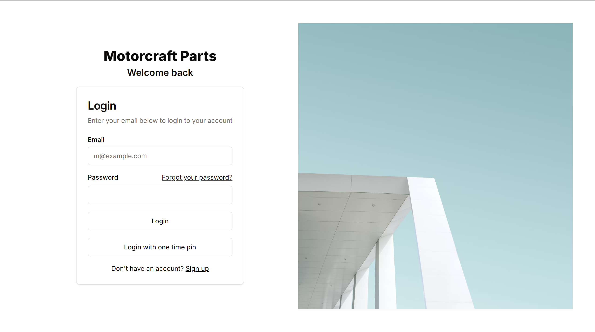
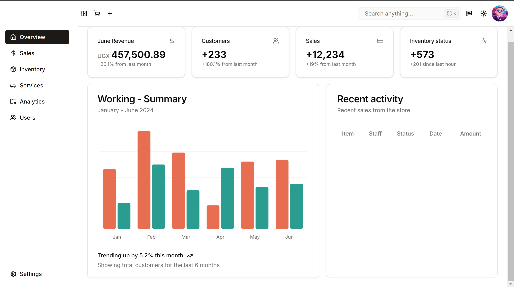
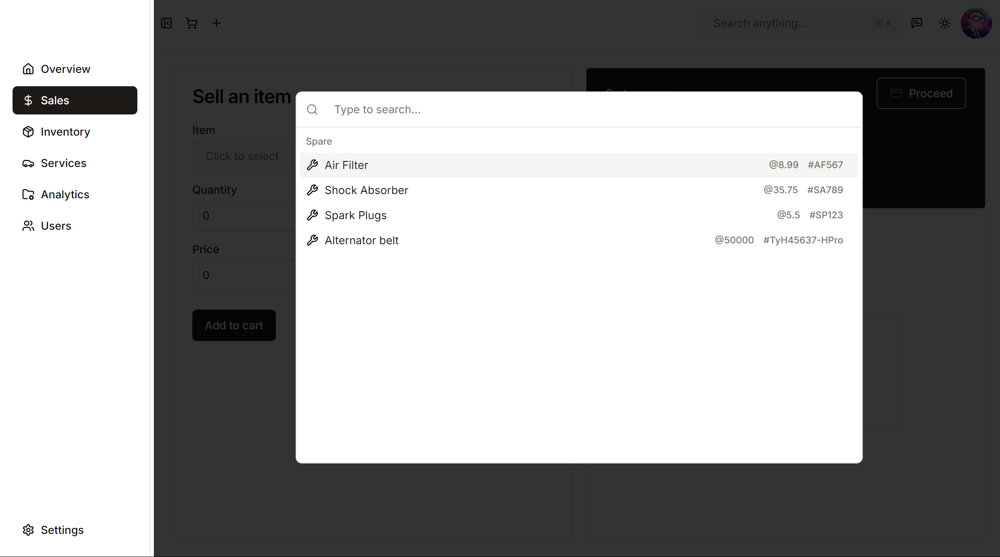
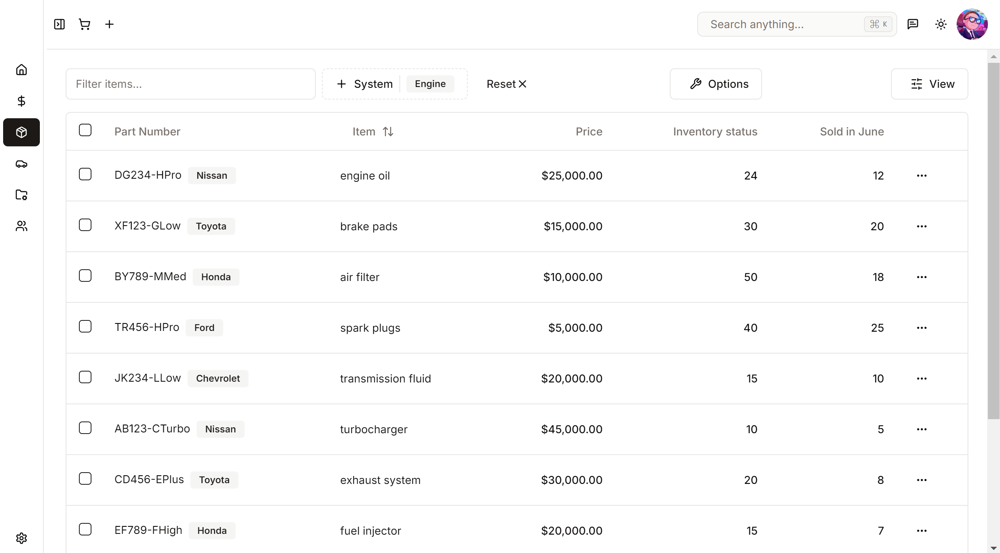
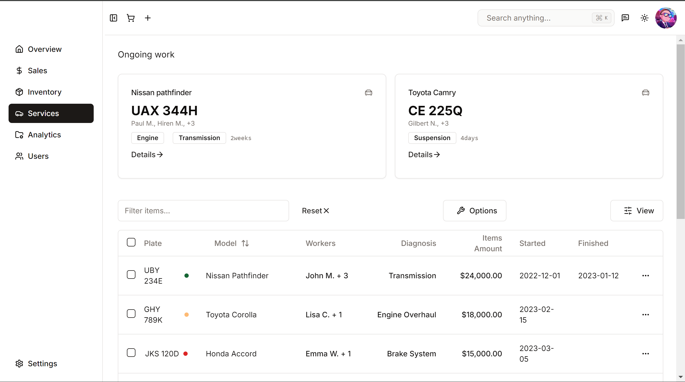

# mcparts

mcparts is a personal prototype of a spare-parts inventory and workshop management tool. It is intended for spare-parts vendors and small vehicle workshops, with screens for inventory, sales, service jobs and reporting.

The workshop/company used in the presentation is fictional. This is an independent personal project, not a commissioned employer or client website. The goal is to develop a tool that can eventually be shared with or sold to vendors.

## Current status

This is an unfinished prototype being resumed after a period of inactivity. The repository includes substantial UI work and database integration, but it should not yet be used with real customer, employee or business records.

| Area | Current implementation |
| --- | --- |
| Inventory | Searchable/filterable table and Supabase read endpoints; editing workflows need completion and verification |
| Sales | Sales form and Supabase list/create/update/delete endpoints; request handling and end-to-end behavior need verification |
| Services | Table UI with hard-coded example records; detail screen is a placeholder |
| Dashboard/reporting | Charts and summary UI; several values are static examples |
| Authentication | Login/signup UI only; login currently navigates to the dashboard without credential verification |
| Users/settings | Placeholder pages |
| Database | Supabase-backed API routes plus separate SQLite/Sequelize prototype models; automatic synchronization is not established |

The latest uploaded snapshot has been inspected statically. A successful installation, build and complete demo walkthrough have not yet been verified.

## Stack

- Next.js 14 and React 18, using JavaScript and the App Router
- Tailwind CSS, Radix UI components, TanStack Table and Recharts
- Supabase for the existing sales/inventory API routes
- SQLite and Sequelize for a separate local database prototype

## Run locally

See [SETUP.md](SETUP.md) for configuration details and known gaps.

```bash
git clone https://github.com/hiren-maddara/mcparts.git
cd mcparts
npm ci
cp .env.example .env.local
# Configure an isolated demo Supabase project before starting.
npm run dev
```

Open http://localhost:3000. The database-backed screens require a compatible Supabase schema and access policies; a fresh clone does not currently provision them automatically.

## Demo and screenshots

Previously published demo: https://mcparts.netlify.app. Its current availability and database configuration have not been reverified.

Existing screenshots are historical examples and may not match the current state:







## Planned work

The proposed backlog in [ROADMAP.md](ROADMAP.md) covers reproducible setup, reliable sales/inventory behavior, reporting and tests. Estimates are preliminary; unfinished items are not claims of delivered functionality.

## Data and configuration

Use only synthetic records in public demos and development. Before publishing, verify that database files, screenshots, source fixtures, hosted data and repository history contain no real personal/customer information or secrets. The fictional workshop name alone does not establish that every record is synthetic.

Keep credentials in `.env.local`; never commit real environment files. Authentication, authorization and data access policies require implementation or verification before real use.

## License

MIT; see [LICENSE](LICENSE). Third-party dependencies and assets retain their own licenses and attribution requirements.
